  

  <a href="mailto:farhananwar784@gmail.com">Email</a> ·
  <a href="https://www.linkedin.com/in/mohammed-farhan-anwar-b7a626256/">LinkedIn</a> ·
  <a href="https://farhandev.vercel.app/">Portfolio</a>

### 🛠️ What I build

- **Full-stack SaaS:** white-label, multi-tenant web and mobile apps, admin dashboards, role-based access
- **Payment systems:** card payments, recurring billing, refunds and saved cards
- **AI agents in production:** tool calling and RAG, measured on real data before release
- **Cross-platform apps:** one Flutter codebase for iOS, Android, Web and macOS

### 🧪 How I keep it reliable

| What I do | How |
| :-- | :-- |
| Tests gate every release | pytest and automated test suites run in CI/CD before deploy |
| Catch errors before users report them | Sentry and Crashlytics in production |
| Watch the system, not just the code | Datadog metrics and alerts |
| Plan for failure | retries, rate-limit handling, outage and restart drills |
| Measure AI, don't trust it | eval harness on real cases; rules and dates live in tested code, not prompts |
| Humans approve risky actions | agents ask before changing anything important |
| Secure by default | JWT auth, role-based access, validated inputs |

### 🧰 Stack

  

  

  
  
  
  
  
  
  
  
  

  <picture>
    <source media="(prefers-color-scheme: dark)" srcset="https://raw.githubusercontent.com/farhan1515/farhan1515/output/github-contribution-grid-snake-dark.svg" />
    
  </picture>

